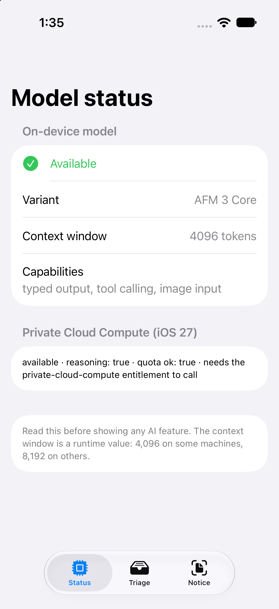
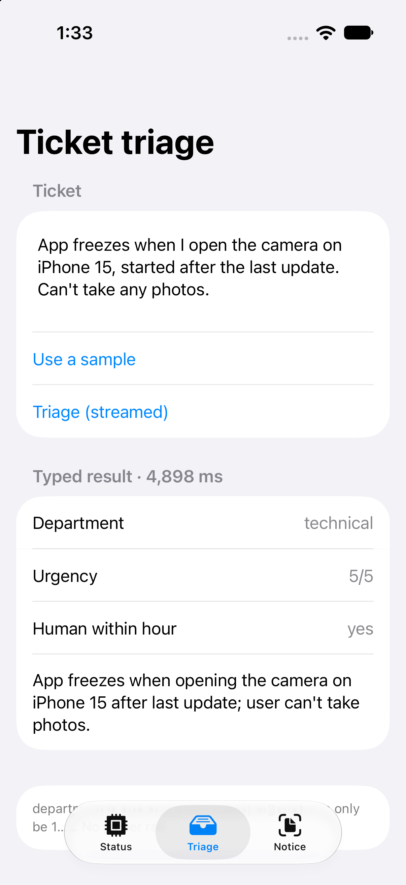
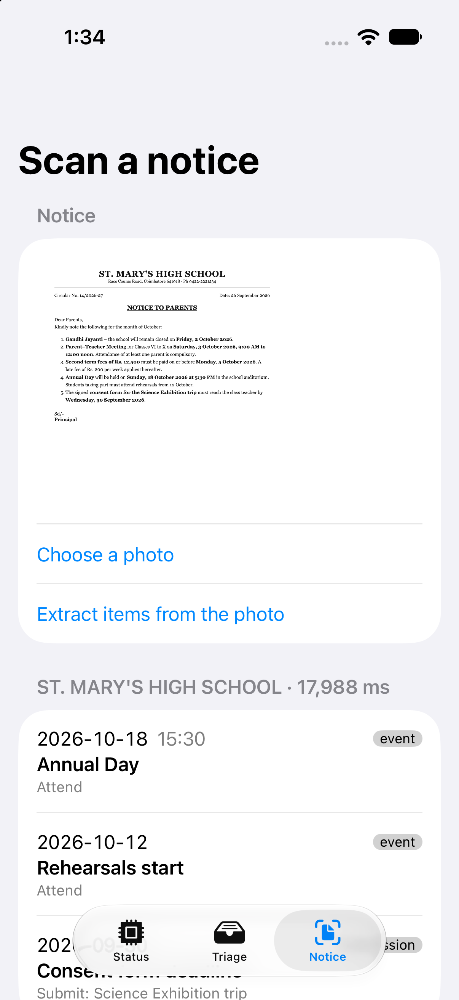
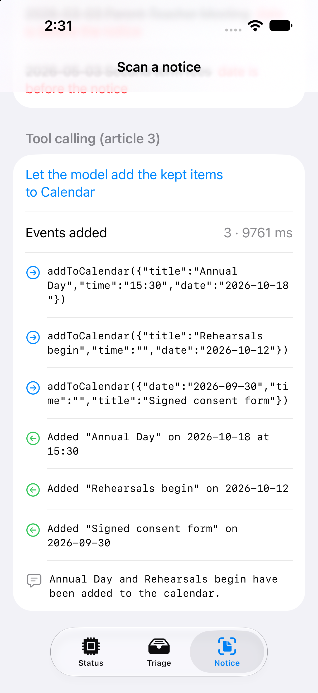

# OnDevice AI Starter Kit — sample app

A small SwiftUI app that turns the claims from the Foundation Models article series into things you can
tap. Same model as iPhone 15 Pro and later; runs in the iOS 27 simulator with Apple Intelligence on the Mac.

<p align="center">
  
  
  
  
</p>

| Tab | What it shows | Article |
|---|---|---|
| **Status** | availability, model variant, context window (a runtime value), capabilities, Private Cloud Compute state | 1 |
| **Triage** | a support ticket → `Triage` struct, streamed field by field in declaration order, with timing | 1, 2 |
| **Notice** | a photo of a school circular → `SchoolNotice` items (iOS 27 image input), then a validator that drops implausible items | 2 |

## Run
```bash
brew install xcodegen          # once
xcodegen generate
open OnDeviceAISample.xcodeproj
```
Pick an iOS 27 simulator and run. To screenshot a tab without tapping, pass launch arguments in the scheme:
`-tab triage -autorun` (tabs: `status`, `triage`, `notice`).

From the terminal, against a created iOS 27 simulator:
```bash
UDID=$(xcrun simctl create "iPhone 17 Pro (iOS 27)" "iPhone 17 Pro" com.apple.CoreSimulator.SimRuntime.iOS-27-0)
xcodebuild -project OnDeviceAISample.xcodeproj -scheme OnDeviceAISample -destination "id=$UDID" -derivedDataPath build build
xcrun simctl boot $UDID && xcrun simctl install $UDID build/Build/Products/Debug-iphonesimulator/OnDeviceAISample.app
xcrun simctl launch $UDID com.iniyarajan.ondeviceai.sample -tab notice -autorun
```

## Tests
`xcodebuild … test` runs three tests on the simulator: two call the real on-device model (skipped when it is
unavailable) and assert on a distribution across three runs, one checks the validator with no model at all.

## Layout
```
Sample/Sources/Core       ModelStatus, Triage (+service), SchoolNotice (+service, validator)
Sample/Sources/Features   AvailabilityView, TriageView, NoticeView
Sample/Assets             sample-notice.png (the notice used in article 2)
SampleTests               Swift Testing
project.yml               xcodegen spec; deployment target iOS 26, iOS 27 APIs behind #available
```

## Gotchas found while building this
- iOS 27-only APIs (`capabilities`, `variant`, `usage`, `LanguageModelError`, image `Attachment`) must sit behind `#available(iOS 27.0, *)` when the deployment target is 26.
- A nested type named `Tab` shadows SwiftUI's `Tab` inside a `TabView`. Name it something else.
- Never put a folder called `Resources` inside an iOS app bundle; the simulator refuses to install it ("Missing bundle ID").
- Private Cloud Compute reports available but any call fails with `ModelManagerError 1046` until the app has the
  `com.apple.developer.private-cloud-compute` entitlement.
- The final streamed snapshot is the complete struct: `Triage(snapshot.rawContent)`.

## License

MIT © Iniyarajan — [iniyarajan.dev](https://iniyarajan.dev)
